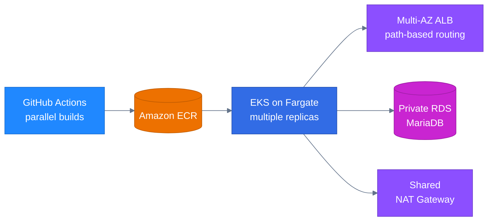
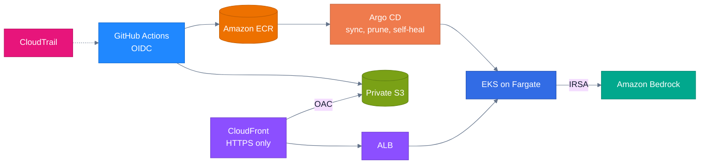
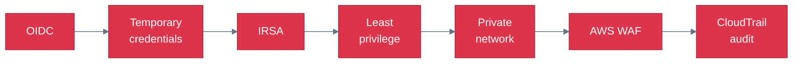

 

 

## About

DevOps engineer based in **Pune, Maharashtra, India**, focused on AWS, Kubernetes and automated delivery. I design cloud platforms with repeatable deployments, keyless CI/CD, least-privilege access and built-in observability.

| | |
|:--|:--|
| **Focus** | AWS infrastructure, EKS / Fargate, CI/CD, GitOps |
| **Security approach** | OIDC, temporary credentials, IRSA, least-privilege IAM |
| **Observability** | Prometheus, Grafana, ELK, CloudWatch, CloudTrail |
| **Exploring next** | Platform engineering, GenAI and AI agents |

 

## Tech Stack

| Area | Tools |
|:--|:--|
| **Compute** |         |
| **Storage and Databases** |       |
| **Networking** |         |
| **Containers** |    |
| **CI/CD and GitOps** |        |
| **Infrastructure as Code** |      |
| **Observability** |       |
| **Security** |       |
| **Languages and OS** |     |
| **Version Control and Hosting** |     |
| **AI Services** |  |

AWS badges use the official AWS service-category colours.

 

## Architecture

How code moves from a commit to a running, observable application:

 

## Projects

### 1. Containerized Web App on Amazon EKS Fargate with GitHub Actions CI/CD

Push-to-deploy pipeline with parallel image builds, ECR push, manifest apply and rollout verification on EKS Fargate.

| ~80% | ~50% |
|:--:|:--:|
| less manual deployment effort | lower networking cost on selected non-prod traffic |

- VPC prepared for Fargate, with a NAT Gateway and a private pod subnet
- Private RDS MariaDB with a security group scoped to the VPC CIDR
- AWS Load Balancer Controller using an IRSA role limited to one service account
- Frontend and API served behind one ALB with path-based routing

        

 

### 2. Production GitOps on EKS Fargate with CloudFront and Keyless CI/CD

Production delivery with no long-lived AWS credentials, and a cluster that corrects its own configuration drift.

| 100% | ~85% | ~30% |
|:--:|:--:|:--:|
| long-lived AWS credentials eliminated | less manual release effort | lower compute spend through sizing and edge caching |

- Trust policy restricted to one repository and one branch
- Static build synced to private S3 and served through CloudFront with OAC
- ALB as the API origin, with HTTPS-only access
- Least-privilege Bedrock policy for the backend pod via IRSA

          

 

### 3. Microservices Migration from Docker Compose to Kubernetes on Amazon EKS

Three Spring Boot microservices and a React/Vite frontend moved from a single EC2 host to EKS.

```mermaid
%%{init: {'theme':'base','themeVariables':{'fontFamily':'Inter, ui-sans-serif, system-ui, sans-serif','lineColor':'#64748B','primaryTextColor':'#0F172A'}}}%%
flowchart LR
  DC["Docker Compose<br/>single EC2 host"] --> SV["Containerized<br/>services"] --> ECR[("Amazon ECR")] --> EKS["EKS<br/>manifests, HPA"] --> ALB["ALB Ingress"] --> R53["Route 53<br/>Certbot SSL"] --> PROD(["Production"])

  classDef docker fill:#2496ED,stroke:#1D7BC4,color:#FFFFFF
  classDef aws fill:#ED7100,stroke:#C25C00,color:#FFFFFF
  classDef net fill:#8C4FFF,stroke:#6F3FCC,color:#FFFFFF
  classDef k8s fill:#326CE5,stroke:#2653B3,color:#FFFFFF
  classDef done fill:#16A34A,stroke:#128038,color:#FFFFFF
  class DC,SV docker
  class ECR aws
  class ALB,R53 net
  class EKS k8s
  class PROD done
```

| ~70% |
|:--:|
| less environment setup effort |

- Namespace, ConfigMap, Deployment, Service, ALB Ingress and HPA manifests
- Cluster created with eksctl, Load Balancer Controller configured with IRSA
- NAT Gateway for a stable egress IP
- Idempotent bootstrap script that seeds organizations and users

      

 

## Problems Solved in Production

Real failures hit while building the projects above, with the cause and the fix. Expand a project to read it.

<b>Project 1 · EKS Fargate with GitHub Actions</b> &nbsp;(5 issues)

 

| Symptom | Root cause |
|:--|:--|
| Pods stuck in `Pending` | Fargate scheduling configuration |
| CoreDNS failures | Cluster DNS setup on Fargate |
| `ImagePullBackOff` | Missing NAT route from the private subnet |
| `CrashLoopBackOff` | RDS security-group rules |
| ALB `502` | Traced through target health and logs |

<b>Project 2 · Keyless GitOps on EKS Fargate</b> &nbsp;(6 issues)

 

| Symptom | Root cause |
|:--|:--|
| OIDC `AccessDenied` | IAM trust relationship, found through CloudTrail |
| Argo CD CRD size limit | Solved with server-side apply |
| Admission webhook failure | A failing webhook was blocking deployments |
| EKS access policy errors | Cluster access had to be granted explicitly |
| Fargate profile immutability | Profiles cannot be edited in place |
| `runAsNonRoot` UID errors | Container user IDs conflicting with the security policy |

<b>Project 3 · Docker Compose to EKS</b> &nbsp;(1 issue)

 

| Symptom | Root cause |
|:--|:--|
| Hostname mismatches | Configuration defects found during cutover |

 

## Security Model

## Observability Model

 

## Currently Learning

Extending my infrastructure background into AI and machine learning, with a focus on building and deploying AI systems.

| Topic | What I'm exploring | Tools |
|:--|:--|:--|
| **Generative AI** | LLM fundamentals, prompt design, RAG, managed model access |   |
| **LangChain** | Chains, prompts, retrievers and tool integrations |  |
| **LangGraph** | Stateful, multi-step AI agent workflows |  |
| **Machine Learning** | Core algorithms, model training and evaluation |   |
| **Deep Learning** | Neural networks and modern architectures |   |
| **AI Infrastructure** | Running and deploying AI workloads on AWS and Kubernetes |   |

**Also exploring:** Platform Engineering · GitOps · Cloud Security · Cost Optimization · Production Reliability

 

## GitHub Activity

 

## Let's Connect

