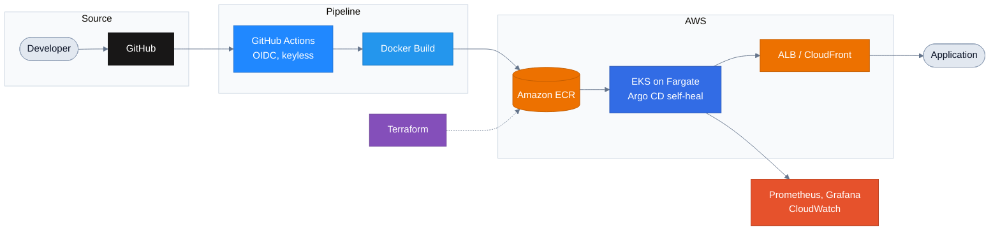
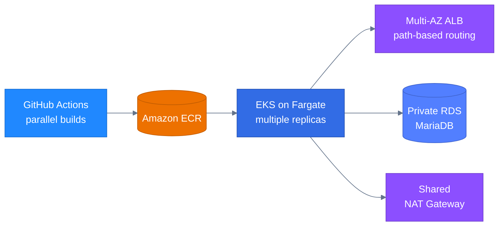
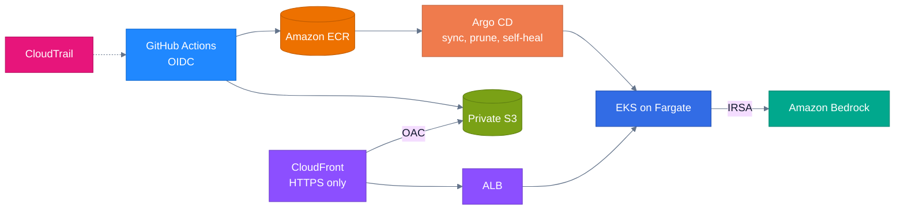
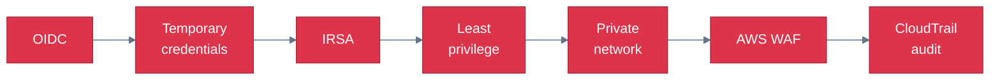
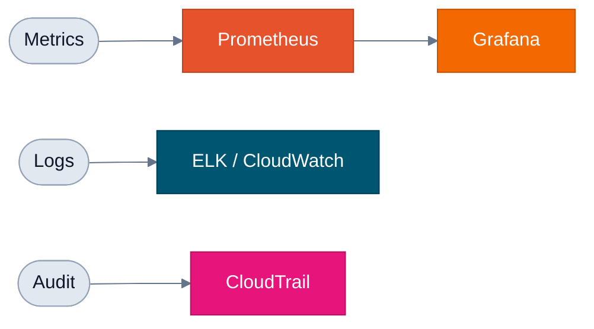

<div align="center">


# ROHIT MAHAJAN

### DevOps &amp; Cloud Engineer

**AWS** · **Kubernetes** · **CI/CD &amp; GitOps** · **Infrastructure Automation** · **GenAI**


<br/>

<a href="#about"></a>
<a href="#skills"></a>
<a href="#architecture"></a>
<a href="#projects"></a>
<a href="#problems-solved"></a>
<a href="#security-observability"></a>
<a href="#currently-learning"></a>
<a href="#github"></a>
<a href="#contact"></a>

</div>

<br/>
<br/>

---

<br/>

<div align="center">

<a name="about"></a>


</div>

<br/>

```yaml
name:      Rohit Mahajan
role:      "DevOps & Cloud Engineer"
location:  "Pune, Maharashtra, India"
focus:     [AWS, EKS, Fargate, CI/CD, GitOps]
security:  [OIDC, temporary-credentials, IRSA, least-privilege-IAM]
observe:   [Prometheus, Grafana, ELK, CloudWatch, CloudTrail]
learning:  [GenAI, LangChain, LangGraph, ML, DL]
```

<div align="center">

**Impact at a glance**


</div>

<br/>
<br/>

---

<br/>

<div align="center">

<a name="skills"></a>


<br/>
<br/>


       


     


         


         


     


   


    


    


         


     

</div>

<br/>
<br/>

---

<br/>

<div align="center">

<a name="architecture"></a>


</div>

<br/>



> [!TIP]
> Every node uses its tool's brand colour: GitHub black, Actions blue, Docker light blue, AWS orange, Kubernetes blue, Prometheus red, Terraform violet.

<br/>
<br/>

---

<br/>

<div align="center">

<a name="projects"></a>


<br/>
<br/>


### Containerized Web App on Amazon EKS Fargate<br/>with GitHub Actions CI/CD

*Push-to-deploy pipeline: parallel image builds, ECR push, manifest apply and rollout verification on EKS Fargate.*

</div>



<div align="center">


</div>

- **Network:** VPC prepared for Fargate, with a NAT Gateway and a private pod subnet
- **Database:** private RDS MariaDB with a security group scoped to the VPC CIDR
- **Access:** AWS Load Balancer Controller using an IRSA role limited to one service account
- **Routing:** frontend and API served behind one ALB with path-based routing

<div align="center">

          

</div>

<br/>

---

<br/>

<div align="center">


### Production GitOps on EKS Fargate<br/>with CloudFront and Keyless CI/CD

*Production delivery with no long-lived AWS credentials, and a cluster that corrects its own configuration drift.*

</div>



<div align="center">


</div>

- **Trust:** policy restricted to one repository and one branch
- **Delivery:** static build synced to private S3 and served through CloudFront with OAC
- **Origin:** ALB as the API origin, with HTTPS-only access
- **AI access:** least-privilege Bedrock policy for the backend pod via IRSA

<div align="center">

           

</div>

<br/>

---

<br/>

<div align="center">


### Microservices Migration from Docker Compose<br/>to Kubernetes on Amazon EKS

*Three Spring Boot microservices and a React/Vite frontend moved from a single EC2 host to EKS.*

</div>


<div align="center">


</div>

- **Manifests:** Namespace, ConfigMap, Deployment, Service, ALB Ingress and HPA
- **Cluster:** created with eksctl, Load Balancer Controller configured with IRSA
- **Egress:** NAT Gateway for a stable egress IP
- **Bootstrap:** idempotent script that seeds organizations and users

<div align="center">

         

</div>

<br/>
<br/>

---

<br/>

<div align="center">

<a name="problems-solved"></a>


</div>

<br/>

> [!WARNING]
> Expand a project below to see each failure and what was behind it.

<details>
<summary><b>Project 01 · EKS Fargate with GitHub Actions</b> &nbsp;(5 issues)</summary>

```diff
- Pods stuck in Pending
+ Cause: Fargate scheduling configuration

- CoreDNS failures
+ Cause: cluster DNS setup on Fargate

- ImagePullBackOff
+ Cause: missing NAT route from the private subnet

- CrashLoopBackOff
+ Cause: RDS security-group rules

- ALB 502
+ Cause: traced through target health and logs
```

</details>

<details>
<summary><b>Project 02 · Keyless GitOps on EKS Fargate</b> &nbsp;(6 issues)</summary>

```diff
- OIDC AccessDenied
+ Cause: IAM trust relationship, found through CloudTrail

- Argo CD CRD size limit
+ Cause: solved with server-side apply

- Admission webhook failure
+ Cause: a failing webhook was blocking deployments

- EKS access policy errors
+ Cause: cluster access had to be granted explicitly

- Fargate profile immutability
+ Cause: profiles cannot be edited in place

- runAsNonRoot UID errors
+ Cause: container user IDs conflicting with the security policy
```

</details>

<details>
<summary><b>Project 03 · Docker Compose to EKS</b> &nbsp;(1 issue)</summary>

```diff
- Hostname mismatches
+ Cause: configuration defects found during cutover
```

</details>

<br/>
<br/>

---

<br/>

<div align="center">

<a name="security-observability"></a>


<br/>
<br/>


</div>



<div align="center">


</div>



<br/>
<br/>

---

<br/>

<div align="center">

<a name="currently-learning"></a>


</div>

<br/>



<div align="center">

```mermaid
%%{init: {'theme':'base','themeVariables':{'fontFamily':'Inter, ui-sans-serif, system-ui, sans-serif','lineColor':'#64748B','primaryTextColor':'#FFFFFF'}}}%%
flowchart LR
  INF["DevOps and Cloud<br/>foundation"] --> GEN["Generative AI"] --> LC["LangChain"] --> LG["LangGraph"] --> AG["AI systems on<br/>AWS and Kubernetes"]
  INF --> ML["Machine Learning"] --> DL["Deep Learning"] --> GEN

  classDef base fill:#326CE5,stroke:#2653B3,color:#FFFFFF
  classDef ai fill:#01A88D,stroke:#018570,color:#FFFFFF
  classDef lc fill:#1C3C3C,stroke:#0F2424,color:#FFFFFF
  classDef ml fill:#F7931E,stroke:#C4760F,color:#FFFFFF
  classDef dl fill:#EE4C2C,stroke:#BC3B21,color:#FFFFFF
  classDef goal fill:#ED7100,stroke:#C25C00,color:#FFFFFF
  class INF base
  class GEN ai
  class LC,LG lc
  class ML ml
  class DL dl
  class AG goal
```

| | Topic | What I'm exploring |
|:--:|:--|:--|
|   | **Generative AI** | LLM fundamentals, prompt design, RAG and managed model access |
|  | **LangChain** | Chains, prompts, retrievers and tool integrations |
|  | **LangGraph** | Stateful, multi-step AI agent workflows |
|   | **Machine Learning** | Core algorithms, model training and evaluation |
|   | **Deep Learning** | Neural networks and modern architectures |
|   | **AI Infrastructure** | Running and deploying AI workloads on AWS and Kubernetes |

</div>

> [!NOTE]
> Also exploring: Platform Engineering, GitOps, Cloud Security, Cost Optimization and Production Reliability.

<br/>
<br/>

---

<br/>

<div align="center">

<a name="github"></a>


<br/>
<br/>

<a href="https://github.com/Rohit-1920"></a>
<a href="https://github.com/Rohit-1920?tab=repositories"></a>

</div>

<br/>
<br/>

---

<br/>

<div align="center">

<a name="contact"></a>


<br/>
<br/>

<a href="https://linkedin.com/in/rohit-m-934a66222"></a>
<a href="https://github.com/Rohit-1920"></a>
<a href="mailto:mahajanrohit759@gmail.com"></a>

<br/>
<br/>


</div>
