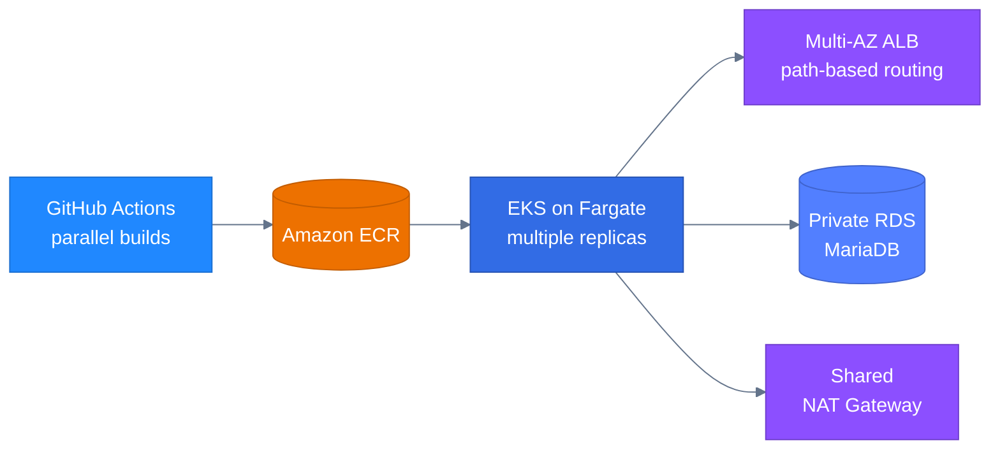
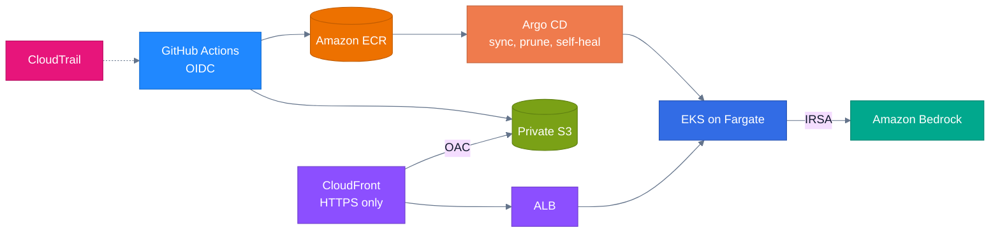
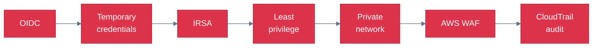

<h1 align="center">Rohit Mahajan</h1>

<h3 align="center">DevOps &amp; Cloud Engineer</h3>

<p align="center">
AWS &nbsp;·&nbsp; Kubernetes (EKS) &nbsp;·&nbsp; CI/CD &amp; GitOps &nbsp;·&nbsp; Infrastructure Automation &nbsp;·&nbsp; GenAI
</p>

<p align="center">


</p>

<p align="center">
<a href="#about">About</a> &nbsp;|&nbsp;
<a href="#skills">Skills</a> &nbsp;|&nbsp;
<a href="#architecture">Architecture</a> &nbsp;|&nbsp;
<a href="#projects">Projects</a> &nbsp;|&nbsp;
<a href="#problems-solved">Problems Solved</a> &nbsp;|&nbsp;
<a href="#currently-learning">Learning</a> &nbsp;|&nbsp;
<a href="#github">GitHub</a> &nbsp;|&nbsp;
<a href="#contact">Contact</a>
</p>

---

<a name="about"></a>
## About

```text
$ whoami
rohit-mahajan

role        DevOps & Cloud Engineer
location    Pune, Maharashtra, India
focus       AWS infrastructure, EKS / Fargate, CI/CD, GitOps
security    OIDC, temporary credentials, IRSA, least-privilege IAM
observe     Prometheus, Grafana, ELK, CloudWatch, CloudTrail
learning    GenAI, LangChain, LangGraph, Machine Learning, Deep Learning
```

---

<a name="skills"></a>
## Skills

### AWS Compute
       

### AWS Storage and Databases
     

### AWS Networking and Integration
         

### AWS Management and Developer Tools
         

### Containers and Orchestration
     

### CI/CD and GitOps
   

### Infrastructure as Code and Scripting
    

### Observability
    

### Security
         

### Operating Systems, Web and Version Control
     

---

<a name="architecture"></a>
## Architecture

From commit to a running, observable application:


---

<a name="projects"></a>
## Projects

### 1. Containerized Web App on Amazon EKS Fargate with GitHub Actions CI/CD

Push-to-deploy pipeline with parallel image builds, ECR push, manifest apply and rollout verification on EKS Fargate.



| Result | Impact |
|:--|:--|
| Manual deployment effort | **~80% reduced** |
| Networking cost (selected non-prod traffic) | **~50% reduced** |

- VPC prepared for Fargate, with a NAT Gateway and a private pod subnet
- Private RDS MariaDB with a security group scoped to the VPC CIDR
- AWS Load Balancer Controller using an IRSA role limited to one service account
- Frontend and API served behind one ALB with path-based routing

          

---

### 2. Production GitOps on EKS Fargate with CloudFront and Keyless CI/CD

Production delivery with no long-lived AWS credentials, and a cluster that corrects its own configuration drift.



| Result | Impact |
|:--|:--|
| Long-lived AWS credentials | **100% eliminated** |
| Manual release effort | **~85% reduced** |
| Compute spend (sizing and edge caching) | **~30% reduced** |

- Trust policy restricted to one repository and one branch
- Static build synced to private S3 and served through CloudFront with OAC
- ALB as the API origin, with HTTPS-only access
- Least-privilege Bedrock policy for the backend pod via IRSA

           

---

### 3. Microservices Migration from Docker Compose to Kubernetes on Amazon EKS

Three Spring Boot microservices and a React/Vite frontend moved from a single EC2 host to EKS.


| Result | Impact |
|:--|:--|
| Environment setup effort | **~70% reduced** |

- Namespace, ConfigMap, Deployment, Service, ALB Ingress and HPA manifests
- Cluster created with eksctl, Load Balancer Controller configured with IRSA
- NAT Gateway for a stable egress IP
- Idempotent bootstrap script that seeds organizations and users

         

---

<a name="problems-solved"></a>
## Problems Solved in Production

Real failures from the projects above, with the cause behind each. Expand a project to read it.

<details>
<summary><b>Project 1 · EKS Fargate with GitHub Actions</b> &nbsp;(5 issues)</summary>
<br/>

| Symptom | Root cause |
|:--|:--|
| Pods stuck in `Pending` | Fargate scheduling configuration |
| CoreDNS failures | Cluster DNS setup on Fargate |
| `ImagePullBackOff` | Missing NAT route from the private subnet |
| `CrashLoopBackOff` | RDS security-group rules |
| ALB `502` | Traced through target health and logs |

</details>

<details>
<summary><b>Project 2 · Keyless GitOps on EKS Fargate</b> &nbsp;(6 issues)</summary>
<br/>

| Symptom | Root cause |
|:--|:--|
| OIDC `AccessDenied` | IAM trust relationship, found through CloudTrail |
| Argo CD CRD size limit | Solved with server-side apply |
| Admission webhook failure | A failing webhook was blocking deployments |
| EKS access policy errors | Cluster access had to be granted explicitly |
| Fargate profile immutability | Profiles cannot be edited in place |
| `runAsNonRoot` UID errors | Container user IDs conflicting with the security policy |

</details>

<details>
<summary><b>Project 3 · Docker Compose to EKS</b> &nbsp;(1 issue)</summary>
<br/>

| Symptom | Root cause |
|:--|:--|
| Hostname mismatches | Configuration defects found during cutover |

</details>

---

## Security and Observability Model

**Security flow**



**Observability flow**


---

<a name="currently-learning"></a>
## Currently Learning

Extending my infrastructure background into AI and machine learning, with a focus on building and deploying AI systems.

**Generative AI** &nbsp;  
LLM fundamentals, prompt design, RAG and managed model access.

**LangChain** &nbsp; 
Chains, prompts, retrievers and tool integrations.

**LangGraph** &nbsp; 
Stateful, multi-step AI agent workflows.

**Machine Learning** &nbsp;  
Core algorithms, model training and evaluation.

**Deep Learning** &nbsp;  
Neural networks and modern architectures.

**AI Infrastructure** &nbsp;  
Running and deploying AI workloads on AWS and Kubernetes.

**Also exploring:** Platform Engineering · GitOps · Cloud Security · Cost Optimization · Production Reliability

---

<a name="github"></a>
## GitHub

<p align="center">
<a href="https://github.com/Rohit-1920"></a>
<a href="https://github.com/Rohit-1920?tab=repositories"></a>
</p>

---

<a name="contact"></a>
<div align="center">

## Let's Connect

<a href="https://linkedin.com/in/rohit-m-934a66222"></a>
<a href="https://github.com/Rohit-1920"></a>
<a href="mailto:mahajanrohit759@gmail.com"></a>

</div>
